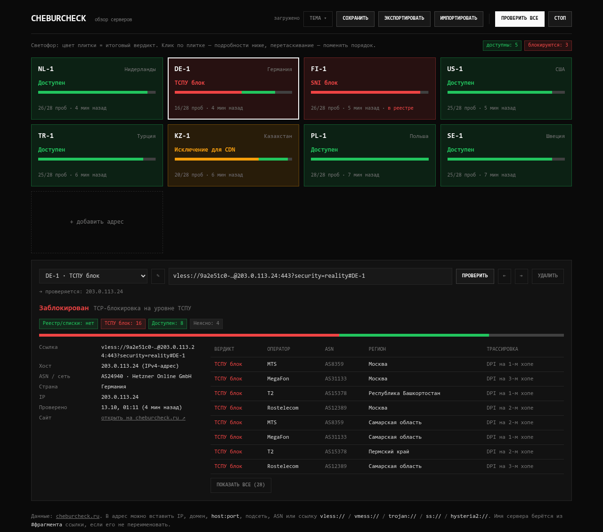
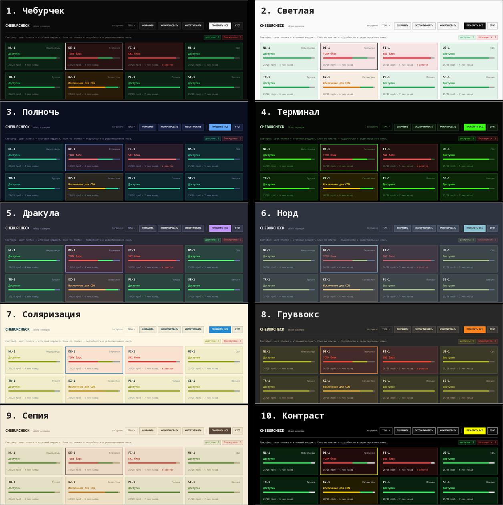
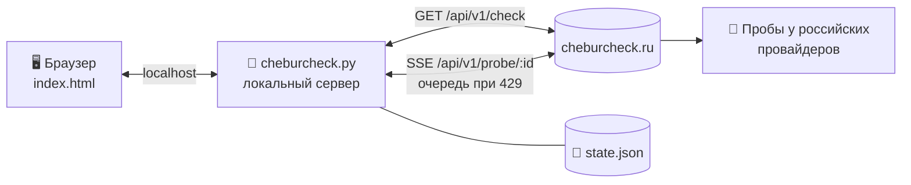

<div align="center">


# Cheburcheck Multi

**Проверка всех ваших VPN-серверов на блокировки в России — одним нажатием.**

Вставьте ссылки `vless://` · `vmess://` · `trojan://` · `ss://` · `hysteria2://` — и увидите, какие серверы режет ТСПУ, у каких операторов и в каких регионах.<br>
Готовая программа для **Windows**, **Linux** и **macOS** — скачал и запустил.

[](https://github.com/h0r1ze/Cheburcheck-Multi/releases/latest)
[](#-быстрый-старт)
[](#-быстрый-старт)
[](#-быстрый-старт)
[](#-быстрый-старт)
[](LICENSE)
[](https://github.com/h0r1ze/Cheburcheck-Multi/stargazers)

[**⬇ Скачать**](#-быстрый-старт) ·
[Быстрый старт](#-быстрый-старт) ·
[Как пользоваться](#-как-пользоваться) ·
[Как читать результат](#-как-читать-результат) ·
[Темы](#-10-тем-оформления) ·
[FAQ](#-faq)

<br>

<picture>
  <source media="(prefers-color-scheme: dark)" srcset="docs/hero-dark.png">
  <source media="(prefers-color-scheme: light)" srcset="docs/hero-light.png">
  
</picture>

<sub>На скриншоте выдуманные серверы и демонстрационные данные.</sub>

</div>

---

## ✨ Возможности

<table>
<tr>
<td width="50%" valign="top">

### 🚦 Плитки-светофор
Цвет плитки = итоговый вердикт. Состояние всех серверов видно за секунду, клик по плитке — подробности. Порядок меняется перетаскиванием.

</td>
<td width="50%" valign="top">

### 📡 Пробы по операторам
Живые результаты с узлов у МТС, Билайна, МегаФона, Т2, Ростелекома и др.: на каком хопе стоит DPI, в каких регионах блок.

</td>
</tr>
<tr>
<td valign="top">

### 🔗 Любые ссылки
`vless`, `vmess`, `trojan`, `ss`, `hysteria2`, `host:port`, IP, домен, подсеть, ASN. Хост и имя (`#NL-1`) извлекаются автоматически. Серверов — сколько угодно.

</td>
<td valign="top">

### 💾 Сохранение, экспорт, импорт
Список хранится локально в `state.json`. Экспорт в `.json`, импорт из файла, списка ссылок или base64-подписки.

</td>
</tr>
<tr>
<td valign="top">

### ⏳ Умная очередь
Сайт пускает 5 запусков проб в минуту — приложение само выстраивает очередь и повторяет запросы, ничего не теряется.

</td>
<td valign="top">

### 🎨 10 тем оформления
От тёмной «Чебурчек» до «Терминала» и «Сепии» плюс «Авто» по системе. Тема запоминается.

</td>
</tr>
</table>

## 🚀 Быстрый старт

Скачайте программу для своей системы — **Python не нужен**:

| Система | Скачать |
|---|---|
| 🪟 **Windows 10 / 11** | [**Cheburcheck-Multi-Windows-x64.exe**](https://github.com/h0r1ze/Cheburcheck-Multi/releases/latest/download/Cheburcheck-Multi-Windows-x64.exe) |
| 🐧 **Linux** x64 | [**Cheburcheck-Multi-Linux-x64.tar.gz**](https://github.com/h0r1ze/Cheburcheck-Multi/releases/latest/download/Cheburcheck-Multi-Linux-x64.tar.gz) |
| 🐧 **Linux** ARM64 · Raspberry Pi (64-битная ОС) | [**Cheburcheck-Multi-Linux-arm64.tar.gz**](https://github.com/h0r1ze/Cheburcheck-Multi/releases/latest/download/Cheburcheck-Multi-Linux-arm64.tar.gz) |
| 🍎 **macOS** Apple Silicon | [**Cheburcheck-Multi-macOS-arm64.tar.gz**](https://github.com/h0r1ze/Cheburcheck-Multi/releases/latest/download/Cheburcheck-Multi-macOS-arm64.tar.gz) |
| 🧩 Любая система с Python 3.8+ | [Cheburcheck-Multi.zip](https://github.com/h0r1ze/Cheburcheck-Multi/releases/latest/download/Cheburcheck-Multi.zip) |

**Windows** — запустите `.exe`. Если появится «Windows защитила ваш компьютер», нажмите **Подробнее → Выполнить в любом случае** (программа не подписана сертификатом).

**Linux** (нужна glibc 2.35+: Ubuntu 22.04+, Debian 12+, Fedora 36+ и новее; на более старых — запуск через Python):

```bash
tar xzf Cheburcheck-Multi-Linux-*.tar.gz
./cheburcheck-multi
```

**macOS** — неподписанную программу нужно один раз разблокировать:

```bash
tar xzf Cheburcheck-Multi-macOS-arm64.tar.gz
xattr -c cheburcheck-multi
./cheburcheck-multi
```

<details>
<summary><b>Запуск из исходников (Python 3.8+)</b></summary>

Windows: установите [Python 3](https://www.python.org/downloads/) с галочкой **«Add python.exe to PATH»**, распакуйте [Cheburcheck-Multi.zip](https://github.com/h0r1ze/Cheburcheck-Multi/releases/latest/download/Cheburcheck-Multi.zip) и запустите `start.bat`.

Linux / macOS:

```bash
git clone https://github.com/h0r1ze/Cheburcheck-Multi.git
cd Cheburcheck-Multi
./start.sh
```

</details>

Браузер откроется сам на **http://127.0.0.1:18765/**.

Рядом откроется окно терминала с адресом — в Linux тоже, даже при запуске двойным кликом из файлового менеджера. **Выключить программу** — кнопка **«⏻ Выход»** на странице, `Ctrl+C` или закрыть окно терминала. Повторный запуск не создаёт вторую копию — просто открывает вкладку. Список серверов хранится в `state.json` рядом с программой.

<details>
<summary><b>Параметры запуска</b></summary>

```bash
cheburcheck-multi --port 18765    # порт на этот запуск (обычно удобнее сменить его в ⚙ на странице)
cheburcheck-multi --no-browser    # не открывать браузер
cheburcheck-multi --host 0.0.0.0  # доступ из локальной сети (осторожно: без пароля)
cheburcheck-multi --verbose       # логировать запросы
cheburcheck-multi --version       # показать версию
cheburcheck-multi --no-terminal   # Linux: не открывать своё окно терминала (для автозапуска, systemd и т.п.)
```

На Windows — `Cheburcheck-Multi-Windows-x64.exe --port 18765` и т.д., из исходников — `python3 cheburcheck.py --port 18765`.

</details>

## 🕹 Как пользоваться

1. **Добавьте серверы.** Нажмите на пустую плитку или «+ добавить адрес» и вставьте ссылку из VPN-клиента — либо загрузите сразу весь список кнопкой **«Импортировать»** (файл со ссылками, подписка или ранее сохранённый экспорт).
2. **Нажмите «Проверить все».** Плитки окрасятся по мере прихода результатов; если сайт попросит подождать, на плитке появится «в очереди» — приложение продолжит само.
3. **Разберитесь с красными.** Клик по плитке открывает подробности: вердикт, у каких операторов и в каких регионах блок, на каком хопе DPI.
4. **Наведите порядок.** Плитки перетаскиваются мышью, на телефоне — долгим нажатием; с клавиатуры — `Alt` + стрелки или кнопки **← →** под плитками. Имя сервера меняется кнопкой **✎**.
5. **Сохраните.** Всё сохраняется само, но есть и кнопка **«Сохранить»** (`Ctrl+S`); **«Экспортировать»** — чтобы перенести список на другой компьютер. Тема оформления — кнопка **«Тема ▾»**, порт программы — **⚙**. Закончили — **«⏻ Выход»**.

## 🧭 Как читать результат

| | Вердикт | Что это значит для VPN |
|:-:|---|---|
| 🟢 | **Доступен** | Пробы у провайдеров доходят до сервера — ограничений не видно |
| 🔴 | **ТСПУ блок** | Соединение режется DPI у провайдера (показывается, на каком хопе) |
| 🔴 | **SNI блок** | Блокировка по имени домена в TLS — смените SNI / домен маскировки |
| 🔴 | **Подмена DNS** | Провайдер подменяет DNS-ответы для этого домена |
| 🔴 | **CDN блок 16–20 КБ** | Соединение с заблокированным CDN обрывается после 16–20 КБ |
| 🟡 | **Исключение для CDN** | Домен из «белого списка» — снимает ограничение 16–20 КБ |
| ⚪ | **Неясно** | Пробы не дали однозначного ответа |

Отдельно показывается, есть ли адрес **в реестре РКН / списках блокировок**. Итоговый вердикт выбирается большинством проб — так же, как на самом cheburcheck.ru.

## 🎨 10 тем оформления

Кнопка **«Тема ▾»** в шапке. Выбор запоминается и в браузере, и в `state.json`.

<p align="center"></p>

## ⚙️ Как это устроено



- Браузер не может ходить в API сайта напрямую (CORS), поэтому `cheburcheck.py` проксирует запросы, выстраивает очередь проб и хранит состояние.
- Сервер слушает только ваш компьютер (`127.0.0.1`) и принимает изменения только со своей страницы — чужой сайт, открытый в браузере, не может прочитать или перезаписать список серверов и не может выключить программу.
- Весь интерфейс — один файл `index.html` без сборки и библиотек; сервер — один файл на стандартной библиотеке Python.
- Готовые программы собираются из этого же кода (PyInstaller) в [GitHub Actions](.github/workflows/release.yml): каждая сборка перед публикацией запускается и проверяется, к релизу прикладываются контрольные суммы `SHA256SUMS.txt`.
- Вердикт по пробам считается по той же логике, что `selectProbeVerdict` в исходниках [cheburcheck](https://github.com/LowderPlay/cheburcheck/blob/master/frontend/src/lib/api/probe.ts).

<details>
<summary><b>Выпуск новой версии</b></summary>

1. Поменяйте `VERSION` в `cheburcheck.py`, закоммитьте и отправьте изменения.
2. Поставьте тег — дальше всё сделает GitHub Actions (сборка под все системы, проверка, релиз с файлами и `SHA256SUMS.txt`):

```bash
git tag -a v1.2.0 -m "Cheburcheck Multi v1.2.0"
git push origin v1.2.0
```

Собрать программу вручную: `pip install pyinstaller certifi`, затем
`pyinstaller --onefile --name cheburcheck-multi --icon docs/icon.ico --add-data "index.html:." cheburcheck.py` — результат в `dist/`.

</details>

<details>
<summary><b>Структура проекта</b></summary>

| Файл | Назначение |
|---|---|
| `cheburcheck.py` | локальный сервер: страница, прокси к API, очередь проб, `state.json` |
| `index.html` | интерфейс целиком (HTML + CSS + JS) |
| `start.bat` / `start.sh` | запуск из исходников на Windows / Linux и macOS |
| `.github/workflows/release.yml` | сборка программ под Windows, Linux, macOS и публикация релиза |
| `.github/release-notes.md` | шаблон описания релиза (таблица загрузок, инструкции) |
| `docs/` | картинки для README и иконка программы |
| `state.json` | ваши серверы и результаты — создаётся рядом с программой, **в git не попадает** |
| `settings.json` | выбранный порт — создаётся рядом, когда вы меняете порт в ⚙ (или вручную: `{ "port": 25000 }`), **в git не попадает** |

</details>

<details>
<summary><b>Формат экспорта и импорта</b></summary>

Экспорт сохраняет файл `cheburcheck-servers-ГГГГ-ММ-ДД.json`:

```json
{
  "app": "cheburcheck-multi",
  "version": 1,
  "servers": [
    { "name": "NL-1", "link": "vless://…@nl1.example.net:443#NL-1" }
  ]
}
```

Импорт понимает:
- этот же формат и `state.json`;
- JSON-массив ссылок;
- текстовый файл — по ссылке на строку (строки с `#` и `//` в начале пропускаются);
- base64-подписку целиком.

</details>

## ❓ FAQ

<details>
<summary><b>Мои ссылки куда-то отправляются?</b></summary>

На cheburcheck.ru уходит **только хост** (IP или домен) — ни UUID, ни пароли, ни параметры из ссылки не передаются. Сами ссылки хранятся только у вас в `state.json` и в памяти браузера. Сайт, как и при обычном заходе, видит ваш IP-адрес.

</details>

<details>
<summary><b>Порт 18765 занят другой программой / как сменить порт?</b></summary>

Если порт занят, программа сама возьмёт следующий свободный и покажет об этом предупреждение на странице. Чтобы выбрать порт самому, нажмите **⚙** в шапке, впишите любой свободный порт от 1024 до 65535 и нажмите **«Применить»** — программа сразу переедет на него (страница откроется по новому адресу сама) и запомнит выбор для следующих запусков. Если порт занят, она сразу об этом скажет. Выбор хранится в `settings.json` рядом с `state.json`; разово переопределить можно параметром `--port`.

**Сменить порт без страницы** — создайте рядом с программой (в той же папке, где `state.json`) файл `settings.json`:

```json
{ "port": 25000 }
```

При следующем запуске программа откроется на этом порту. Порт — число от 1024 до 65535 без кавычек; при ошибке в файле используется порт по умолчанию 18765. Если папка программы недоступна для записи, `state.json` и `settings.json` лежат в профиле пользователя — путь программа пишет при запуске.

</details>

<details>
<summary><b>Как выключить программу?</b></summary>

Кнопкой **«⏻ Выход»** в правом верхнем углу страницы — программа сохранит список и остановится. Или `Ctrl+C` / закрыть окно терминала. В Linux при запуске двойным кликом программа сама открывает окно терминала, чтобы её было видно и можно было закрыть; если терминала в системе нет, она работает без окна — тогда выключайте кнопкой «Выход».

</details>

<details>
<summary><b>Как обновиться, не потеряв список серверов?</b></summary>

Скачайте новую версию и положите её **в ту же папку**, заменив старый файл, — `state.json` рядом останется, и всё подхватится. Можно и наоборот: перенести `state.json` к новой программе. На всякий случай перед обновлением можно нажать «Экспортировать». Текущая версия видна при запуске и по `--version`.

</details>

<details>
<summary><b>Почему некоторые серверы долго «в очереди»?</b></summary>

Сайт разрешает 5 запусков проб в минуту с одного IP. При проверке 8 серверов последние подождут около минуты — приложение повторит запрос само.

</details>

<details>
<summary><b>Почему для подсети / ASN нет проб?</b></summary>

Сайт запускает пробы только для отдельных IP и доменов. Для подсетей, ASN и частных адресов доступна только проверка по спискам блокировок.

</details>

<details>
<summary><b>Повторная проверка показывает то же самое</b></summary>

cheburcheck.ru кеширует результаты проб на 3 часа. Новое сканирование того же адреса будет после истечения кеша.

</details>

<details>
<summary><b>Windows пишет «Windows защитила ваш компьютер» / ругается антивирус</b></summary>

Программа не подписана платным сертификатом разработчика, поэтому SmartScreen её не знает: нажмите **Подробнее → Выполнить в любом случае**. Некоторые антивирусы ложно срабатывают на любые программы, собранные PyInstaller. Можно сверить файл с `SHA256SUMS.txt` из релиза или запускать из исходников через Python — код открыт.

</details>

<details>
<summary><b>macOS: «не удаётся проверить разработчика»</b></summary>

Это Gatekeeper блокирует неподписанную программу. Один раз выполните в Терминале в папке с программой (команда снимает метку «скачано из интернета»):

```bash
xattr -c cheburcheck-multi
```

Или: правый клик по файлу → **Открыть** → **Открыть**. Для Mac на Intel используйте `Cheburcheck-Multi.zip` и запуск через Python.

</details>

<details>
<summary><b>Где хранится список серверов?</b></summary>

В `state.json` рядом с программой — его можно копировать или удалять. Если папка недоступна для записи (например, `Program Files`), файл создаётся в профиле пользователя: `%APPDATA%\Cheburcheck-Multi` на Windows, `~/Library/Application Support/Cheburcheck-Multi` на macOS, `~/.config/cheburcheck-multi` на Linux. Точный путь программа пишет при запуске.

</details>

<details>
<summary><b>Запуск из исходников: «Python не найден»</b></summary>

Установите Python с [python.org](https://www.python.org/downloads/) и при установке отметьте **«Add python.exe to PATH»**. Затем снова запустите `start.bat`. Или просто скачайте готовую программу — для неё Python не нужен.

</details>

## 🙏 Благодарности

Все данные предоставляет [**cheburcheck.ru**](https://cheburcheck.ru) — open-source проект [LowderPlay/cheburcheck](https://github.com/LowderPlay/cheburcheck) и сеть добровольных проб. Это неофициальный клиент; API может измениться без предупреждения. Если проект полезен — поддержите оригинал ⭐

## 📄 Лицензия

[MIT](LICENSE) © 2026 h0r1ze
