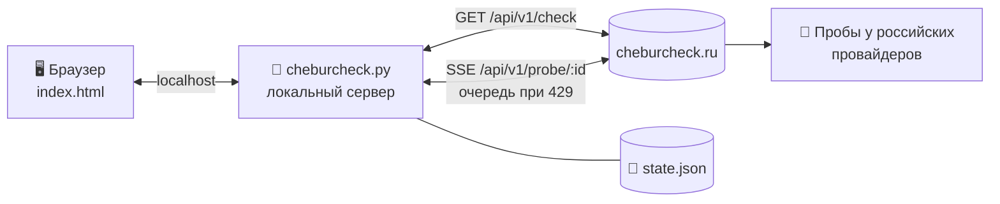

<div align="center">


# Cheburcheck Multi

**Проверка всех ваших VPN-серверов на блокировки в России — одним нажатием.**

Вставьте ссылки `vless://` · `vmess://` · `trojan://` · `ss://` · `hysteria2://` — и увидите, какие серверы режет ТСПУ, у каких операторов и в каких регионах.

[](https://www.python.org/downloads/)
[](#-быстрый-старт)
[](#-как-это-устроено)
[](LICENSE)
[](https://github.com/h0r1ze/Cheburcheck-Multi/stargazers)

[**⬇ Скачать**](https://github.com/h0r1ze/Cheburcheck-Multi/archive/refs/heads/main.zip) ·
[Быстрый старт](#-быстрый-старт) ·
[Как читать результат](#-как-читать-результат) ·
[Темы](#-10-тем-оформления) ·
[FAQ](#-faq)

<br>

<picture>
  <source media="(prefers-color-scheme: dark)" srcset="docs/hero-dark.png">
  <source media="(prefers-color-scheme: light)" srcset="docs/hero-light.png">
  
</picture>

<sub>На скриншоте выдуманные серверы и демонстрационные данные.</sub>

</div>

---

## ✨ Возможности

<table>
<tr>
<td width="50%" valign="top">

### 🚦 Плитки-светофор
Цвет плитки = итоговый вердикт. Состояние всех серверов видно за секунду, клик по плитке — подробности.

</td>
<td width="50%" valign="top">

### 📡 Пробы по операторам
Живые результаты с узлов у МТС, Билайна, МегаФона, Т2, Ростелекома и др.: на каком хопе стоит DPI, в каких регионах блок.

</td>
</tr>
<tr>
<td valign="top">

### 🔗 Любые ссылки
`vless`, `vmess`, `trojan`, `ss`, `hysteria2`, `host:port`, IP, домен, подсеть, ASN. Хост и имя (`#NL-1`) извлекаются автоматически.

</td>
<td valign="top">

### 💾 Сохранение, экспорт, импорт
Список хранится локально в `state.json`. Экспорт в `.json`, импорт из файла, списка ссылок или base64-подписки.

</td>
</tr>
<tr>
<td valign="top">

### ⏳ Умная очередь
Сайт пускает 5 запусков проб в минуту — приложение само выстраивает очередь и повторяет запросы, ничего не теряется.

</td>
<td valign="top">

### 🎨 10 тем оформления
От тёмной «Чебурчек» до «Терминала» и «Сепии» плюс «Авто» по системе. Тема запоминается.

</td>
</tr>
</table>

## 🚀 Быстрый старт

<table>
<tr>
<th>🪟 Windows</th>
<th>🐧 Linux / 🍎 macOS</th>
</tr>
<tr>
<td valign="top">

1. Установите [Python 3](https://www.python.org/downloads/) — отметьте **«Add python.exe to PATH»**.
2. [Скачайте архив](https://github.com/h0r1ze/Cheburcheck-Multi/archive/refs/heads/main.zip) и распакуйте.
3. Дважды щёлкните **`start.bat`**.

</td>
<td valign="top">

```bash
git clone https://github.com/h0r1ze/Cheburcheck-Multi.git
cd Cheburcheck-Multi
./start.sh
```

</td>
</tr>
</table>

Браузер откроется сам на **http://127.0.0.1:18765/**. Повторный запуск не создаёт вторую копию — просто открывает вкладку. Остановить: `Ctrl+C` в окне консоли.

<details>
<summary><b>Параметры запуска</b></summary>

```bash
python3 cheburcheck.py --port 18765    # другой порт (если занят — возьмётся следующий свободный)
python3 cheburcheck.py --no-browser    # не открывать браузер
python3 cheburcheck.py --host 0.0.0.0  # доступ из локальной сети (осторожно: без пароля)
python3 cheburcheck.py --verbose       # логировать запросы
```

</details>

## 🧭 Как читать результат

| | Вердикт | Что это значит для VPN |
|:-:|---|---|
| 🟢 | **Доступен** | Пробы у провайдеров доходят до сервера — ограничений не видно |
| 🔴 | **ТСПУ блок** | Соединение режется DPI у провайдера (показывается, на каком хопе) |
| 🔴 | **SNI блок** | Блокировка по имени домена в TLS — смените SNI / домен маскировки |
| 🔴 | **Подмена DNS** | Провайдер подменяет DNS-ответы для этого домена |
| 🔴 | **CDN блок 16–20 КБ** | Соединение с заблокированным CDN обрывается после 16–20 КБ |
| 🟡 | **Исключение для CDN** | Домен из «белого списка» — снимает ограничение 16–20 КБ |
| ⚪ | **Неясно** | Пробы не дали однозначного ответа |

Отдельно показывается, есть ли адрес **в реестре РКН / списках блокировок**. Итоговый вердикт выбирается большинством проб — так же, как на самом cheburcheck.ru.

## 🎨 10 тем оформления

Кнопка **«Тема ▾»** в шапке. Выбор запоминается и в браузере, и в `state.json`.

<p align="center"></p>

## ⚙️ Как это устроено



- Браузер не может ходить в API сайта напрямую (CORS), поэтому `cheburcheck.py` проксирует запросы, выстраивает очередь проб и хранит состояние.
- Весь интерфейс — один файл `index.html` без сборки и библиотек; сервер — один файл на стандартной библиотеке Python.
- Вердикт по пробам считается по той же логике, что `selectProbeVerdict` в исходниках [cheburcheck](https://github.com/LowderPlay/cheburcheck/blob/master/frontend/src/lib/api/probe.ts).

<details>
<summary><b>Структура проекта</b></summary>

| Файл | Назначение |
|---|---|
| `cheburcheck.py` | локальный сервер: страница, прокси к API, очередь проб, `state.json` |
| `index.html` | интерфейс целиком (HTML + CSS + JS) |
| `start.bat` / `start.sh` | запуск на Windows / Linux и macOS |
| `docs/` | картинки для README |
| `state.json` | ваши серверы и результаты — создаётся при работе, **в git не попадает** |

</details>

<details>
<summary><b>Формат экспорта и импорта</b></summary>

Экспорт сохраняет файл `cheburcheck-servers-ГГГГ-ММ-ДД.json`:

```json
{
  "app": "cheburcheck-multi",
  "version": 1,
  "servers": [
    { "name": "NL-1", "link": "vless://…@nl1.example.net:443#NL-1" }
  ]
}
```

Импорт понимает:
- этот же формат и `state.json`;
- JSON-массив ссылок;
- текстовый файл — по ссылке на строку (строки с `#` и `//` в начале пропускаются);
- base64-подписку целиком.

</details>

## ❓ FAQ

<details>
<summary><b>Мои ссылки куда-то отправляются?</b></summary>

На cheburcheck.ru уходит **только хост** (IP или домен) — ни UUID, ни пароли, ни параметры из ссылки не передаются. Сами ссылки хранятся только у вас в `state.json` и в памяти браузера.

</details>

<details>
<summary><b>Почему некоторые серверы долго «в очереди»?</b></summary>

Сайт разрешает 5 запусков проб в минуту с одного IP. При проверке 8 серверов последние подождут около минуты — приложение повторит запрос само.

</details>

<details>
<summary><b>Почему для подсети / ASN нет проб?</b></summary>

Сайт запускает пробы только для отдельных IP и доменов. Для подсетей, ASN и частных адресов доступна только проверка по спискам блокировок.

</details>

<details>
<summary><b>Повторная проверка показывает то же самое</b></summary>

cheburcheck.ru кеширует результаты проб на 3 часа. Новое сканирование того же адреса будет после истечения кеша.

</details>

<details>
<summary><b>Windows пишет «Python не найден»</b></summary>

Установите Python с [python.org](https://www.python.org/downloads/) и при установке отметьте **«Add python.exe to PATH»**. Затем снова запустите `start.bat`.

</details>

## 🙏 Благодарности

Все данные предоставляет [**cheburcheck.ru**](https://cheburcheck.ru) — open-source проект [LowderPlay/cheburcheck](https://github.com/LowderPlay/cheburcheck) и сеть добровольных проб. Это неофициальный клиент; API может измениться без предупреждения. Если проект полезен — поддержите оригинал ⭐

## 📄 Лицензия

[MIT](LICENSE) © 2026 h0r1ze
